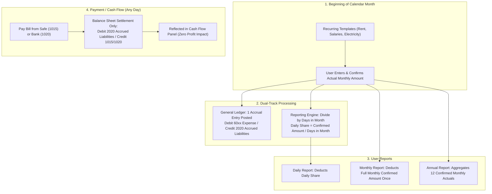

# RetailOS: Universal Retail Management System
## Architectural Blueprint & Technical Specification (v2.5)

---

### Executive Changelog (v2.4 $\rightarrow$ v2.5)
This revision implements the user's explicit architectural clarification, **simplifying the recurring monthly expense workflow**:
1. **Upfront Monthly Actuals (Elimination of Provisional Estimations)**:
   - The business owner enters and confirms the actual values for all recurring monthly commitments (Rent, Salaries, Electricity, Internet, etc.) **at the beginning of each calendar month**.
   - The complex provisional baseline estimation and retroactive redistribution mechanics from v2.4 are **completely removed**.
2. **Simplified Lifecycle & Status**:
   - Monthly expenses enter directly as confirmed actual commitments.
   - Status transitions strictly track obligation settlement: `DUE` $\rightarrow$ `PARTIALLY_PAID` $\rightarrow$ `PAID`.
3. **Transparent Handling of Missing Entries (Zero Invention of Financial Data)**:
   - If a new month commences and the user has not yet entered the monthly expense for an active template:
     - The system **never fabricates or guesses an imaginary amount**.
     - Daily amortized cost for that missing expense is calculated as $\mathbf{\$0.00}$.
     - A high-visibility audit alert banner is surfaced on dashboards and daily reports:
       `[ACTION REQUIRED: Monthly recurring expenses for <Month> have not been entered. Daily operating expenses currently exclude these un-entered items. Click to enter values.]`
     - Once entered, the verified amount immediately begins amortizing across the month's days.
4. **Single Ledger Entry vs. Presentation Daily Share**:
   - When entered, a single general ledger entry is posted for the month (`Debit 60xx Operating Expense`, `Credit 2020 Accrued Liabilities`).
   - Daily reports dynamically compute and display the daily share:
     $$\text{Daily Share} = \left\lfloor \frac{\text{Monthly Confirmed Amount}}{\text{Days In Current Month}} \right\rfloor + \text{Remainder Allocation}$$
     This remains purely a **reporting-layer calculation** (zero daily journal clutter in the database).
5. **Universal Anti-Double-Counting**:
   - Paying a monthly bill settles the liability (`Debit 2020 / Credit 1010, 1015, or 1020`) and reflects strictly in the **Cash Flow Panel**. It is **never** deducted from daily or monthly operating profit on payment day.
   - The monthly report deducts the full confirmed monthly expense **once** (does not sum daily distributions).
   - Past closed accounting periods remain **strictly immutable**.

---

## 1. Operating Expenses Architecture (v2.5 Simplified Model)

### 1.1 The Upfront Entry & Reporting Workflow



---

### 1.2 Mathematical Formulation & Integer Amortization

For any active confirmed recurring monthly expense $k$ in month $M$ of year $Y$:
$$N_{days} = \text{CalendarDaysInMonth}(M, Y) \in \{28, 29, 30, 31\}$$

$$\text{Base Quota}_k = \left\lfloor \frac{\text{Monthly Amount}_k}{N_{days}} \right\rfloor$$
$$R_k = \text{Monthly Amount}_k \pmod{N_{days}}$$

To maintain 100% precision with zero fractional loss in integer minor units (cents/milliemes):
- The first $R_k$ days of the month receive $\text{Base Quota}_k + 1$ minor unit.
- The remaining days receive $\text{Base Quota}_k$.
- **Mathematical Guarantee**:
  $$\sum_{d=1}^{N_{days}} \text{Daily Share}_k(d) \equiv \text{Monthly Amount}_k$$

---

### 1.3 Handling Missing Monthly Entries (No Fictitious Data)
If the user has not yet entered the monthly expense for an active template:
1. **Calculation**: The daily share for this template evaluates to $\$0.00$. The system will **never** guess or invent an arbitrary amount.
2. **Audit & UI Banner**:
   Whenever a report is generated for a period with un-entered recurring expenses, RetailOS attaches a non-blocking warning notice:
   ```
   [!] NOTICE: 2 recurring expense obligations (e.g. November Rent, November Electricity) 
       have not been entered yet. Operating profit currently reflects $0 for these items.
       [Click here to enter November expense amounts]
   ```
3. **Immutable Closed Periods**:
   If an accounting period is formally closed by the administrator without an expense being entered, that period is permanently locked. No user can retroactively alter closed reports.

---

### 1.4 The 8-Tier Daily Presentation & Cash Liquidity Decoupling

```
========================================================================================
RETAILOS DAILY PERFORMANCE REPORT [ Date: 2026-11-01 ] [ Status: CONFIRMED_ACTUAL ]
========================================================================================
1. Gross Sales                                              $ 1,250.00   [ 125,000 cents ]
2. (-) Discounts & Returns                                  $   (70.00)  [  (7,000) cents ]
----------------------------------------------------------------------------------------
3. (=) Net Sales                                            $ 1,180.00   [ 118,000 cents ]
4. (-) Cost of Goods Sold (COGS)                            $  (620.00)  [ (62,000) cents ]
----------------------------------------------------------------------------------------
5. (=) Gross Profit                                         $   560.00   [  56,000 cents ]
----------------------------------------------------------------------------------------
6. (-) Direct Daily Operating Expenses                      $   (25.00)  [  (2,500) cents ]
   (Cleaning supplies, Hospitality vouchers)
7. (-) Daily Amortized Monthly Recurring Expenses           $   (85.00)  [  (8,500) cents ]
   [Rent: $50.00 | Salaries: $25.00 | Electricity: $10.00]
----------------------------------------------------------------------------------------
8. (=) Operating Profit (Net Operating Income)              $   450.00   [  45,000 cents ]
========================================================================================

CASH LIQUIDITY & SETTLEMENT PANEL (Decoupled Cash Flow)
----------------------------------------------------------------------------------------
- Cash Inflow from Retail Cash Sales (POS Drawer):          $ 1,050.00
- Electronic Payments Settled to Bank Account:              $   130.00
- Cash Disbursed for Direct Daily Expenses Today:           $   (25.00)
- Cash Disbursed for Monthly Obligations Settled Today:     $ (1,500.00)  [Nov Rent Paid from Safe]
----------------------------------------------------------------------------------------
* Net Physical Cash Movement Today:                         $  (345.00)
* Total Outstanding Due Obligations (Accrued Liabilities):  $ 2,400.00
========================================================================================
```

---

### 1.5 Database Schema (Simplified for v2.5)

```sql
-- Expense Categories
CREATE TABLE expense_categories (
    id UUID PRIMARY KEY,
    tenant_id UUID NOT NULL,
    code VARCHAR(32) NOT NULL,           -- e.g. "RENT", "SALARIES", "ELECTRICITY", "CLEANING"
    name VARCHAR(64) NOT NULL,
    expense_type VARCHAR(24) NOT NULL CHECK (expense_type IN ('DIRECT_DAILY', 'MONTHLY_RECURRING')),
    account_code VARCHAR(32) NOT NULL DEFAULT '6090',
    is_active BOOLEAN DEFAULT TRUE,
    created_at TIMESTAMP WITH TIME ZONE DEFAULT CURRENT_TIMESTAMP,
    CONSTRAINT uq_exp_cat_tenant_code UNIQUE (tenant_id, code)
);

-- Recurring Monthly Obligation Templates (Defines what needs to be entered each month)
CREATE TABLE recurring_expense_obligations (
    id UUID PRIMARY KEY,
    tenant_id UUID NOT NULL,
    store_id UUID,                       -- Nullable for business-wide overhead (e.g. central marketing)
    category_id UUID NOT NULL REFERENCES expense_categories(id),
    name VARCHAR(128) NOT NULL,          -- e.g. "Store Branch 1 Monthly Rent"
    due_day_of_month INT NOT NULL CHECK (due_day_of_month BETWEEN 1 AND 31),
    currency VARCHAR(3) NOT NULL,
    is_active BOOLEAN DEFAULT TRUE,
    created_at TIMESTAMP WITH TIME ZONE DEFAULT CURRENT_TIMESTAMP
);

-- Monthly Expense Actuals (Entered and Confirmed Upfront by User for Open Months)
CREATE TABLE monthly_expense_actuals (
    id UUID PRIMARY KEY,
    tenant_id UUID NOT NULL,
    store_id UUID,
    obligation_id UUID NOT NULL REFERENCES recurring_expense_obligations(id),
    period_id UUID NOT NULL REFERENCES accounting_periods(id),
    year INT NOT NULL,
    month INT NOT NULL CHECK (month BETWEEN 1 AND 12),
    days_in_month INT NOT NULL CHECK (days_in_month BETWEEN 28 AND 31),
    amount BIGINT NOT NULL CHECK (amount >= 0), -- Actual confirmed amount in minor units
    currency VARCHAR(3) NOT NULL,
    confirmed_at TIMESTAMP WITH TIME ZONE DEFAULT CURRENT_TIMESTAMP,
    confirmed_by_user_id UUID NOT NULL,
    status VARCHAR(16) NOT NULL DEFAULT 'DUE' CHECK (status IN ('DUE', 'PARTIALLY_PAID', 'PAID')),
    paid_amount BIGINT NOT NULL DEFAULT 0,
    journal_entry_id UUID REFERENCES journal_entries(id), -- Single monthly accrual entry in General Ledger
    created_at TIMESTAMP WITH TIME ZONE DEFAULT CURRENT_TIMESTAMP,
    CONSTRAINT uq_monthly_expense_period UNIQUE (tenant_id, obligation_id, year, month)
);

-- Operating Expense Payments & Direct Daily Expenses
CREATE TABLE operating_expense_records (
    id UUID PRIMARY KEY,
    tenant_id UUID NOT NULL,
    store_id UUID,
    category_id UUID NOT NULL REFERENCES expense_categories(id),
    expense_type VARCHAR(24) NOT NULL CHECK (expense_type IN ('DIRECT_DAILY', 'MONTHLY_RECURRING_PAYMENT')),
    monthly_actual_id UUID REFERENCES monthly_expense_actuals(id), -- Linked if paying a monthly obligation
    expense_date DATE NOT NULL,
    amount BIGINT NOT NULL CHECK (amount > 0),
    currency VARCHAR(3) NOT NULL,
    payment_method VARCHAR(32) NOT NULL, -- 'CASH_DRAWER', 'CASH_SAFE', 'BANK_TRANSFER'
    source_account_code VARCHAR(32) NOT NULL, -- '1010', '1015', '1020'
    notes TEXT,
    reference_number VARCHAR(64),
    attachment_path TEXT,
    journal_entry_id UUID REFERENCES journal_entries(id), -- Direct expense or liability settlement
    created_at TIMESTAMP WITH TIME ZONE DEFAULT CURRENT_TIMESTAMP,
    created_by_user_id UUID NOT NULL
);
```

---

## 2. Core Architectural Decisions Summary (ADR-001 to ADR-011)

| ADR | Title | Decision | Status |
| :---: | :--- | :--- | :---: |
| **ADR-001** | Monorepo Tooling | pnpm Workspaces + Turborepo | Approved |
| **ADR-002** | Persistence Layer | Kysely Type-Safe SQL (SQLite + PostgreSQL) | Approved |
| **ADR-003** | Monetary Precision | Currency-Aware `BIGINT` Minor Units | Approved |
| **ADR-004** | Inventory Valuation | Weighted Average Cost (WAC) + Immutable Snapshot | Approved |
| **ADR-005** | Multi-Store Inventory | Partitioned Store Inventories | Approved |
| **ADR-006** | Accounting Depth | Double-Entry Sub-Ledger (Drawer, Safe, Bank) | Approved |
| **ADR-007** | Backup & Recovery | SQLite Online Backup API + 4-Stage Atomic Swap | Approved |
| **ADR-008** | Revenue Presentation | Net Revenue Method with 8-Tier Daily Report | Approved |
| **ADR-009** | Negative Stock Policy | Strict Prohibition by default | Approved |
| **ADR-010** | VAT Scope | Excluded from current scope | Approved |
| **ADR-011** | Expense Amortization & Entry Model | Upfront Monthly Entry + Dynamic Daily Reporting Amortization + Zero Fictitious Values | **Approved (v2.5)** |

---
*Status: Architecture Blueprint v2.5 Finalized. Awaiting explicit user approval before Phase 1 code initiation.*
